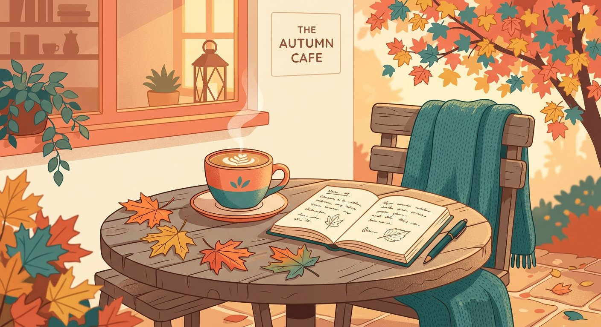
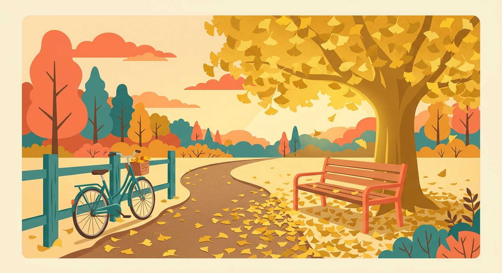

十月的第一个周末，天气预报说多云转晴。我决定不带目的地出门，只是走走——顺便试试新买的相机。

<!--more-->

## 转角的咖啡馆

沿着河边走了二十分钟，我在一家没去过的咖啡馆停下来。木桌上落了两片枫叶，拿铁端上来的时候还在冒热气。我盯着杯口的拉花看了一会儿，觉得这就是秋天该有的开场。

*图 1：拿铁、笔记本，和落在桌角的枫叶*

## 银杏铺满的小路

继续往公园方向走，一条小路被银杏染成了金黄色。长椅上没有人，自行车靠在篱笆边，风一吹，叶子就簌簌地往下落。

*图 2：下午四点的光，刚刚好*

## 关于「散步」这件事

走了两个多小时，没遇到什么大事，但回家路上心情出奇地好。我想，散步的意义大概就在于此：它不解决问题，但它把你从问题里暂时拿出来。

> 「所有真正伟大的想法，都是在行走中诞生的。」—— 尼采

下次打算去更远的河边看看。如果你也有私藏的散步路线，欢迎留言告诉我。
