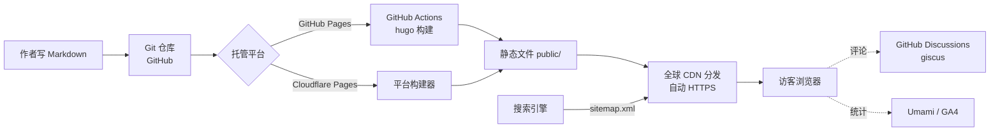

# 第二部分：推荐架构、目录结构与技术栈

## 1. 总体架构



要点：

- **内容与代码同仓**：`content/` 里的 Markdown 就是数据，仓库本身即备份；
- **构建产物不入库**：`public/` 由 CI 生成（已加入 `.gitignore`）；
- **无服务器、无数据库、无后台**：安全与成本的最优解；
- **评论/统计解耦**：均为第三方旁路服务，挂掉不影响正文阅读。

## 2. 技术栈清单

| 层 | 选型 | 版本 | 作用 |
|---|---|---|---|
| 生成器 | Hugo **extended** | v0.167.0（Actions 已锁定） | Markdown → HTML |
| 主题 | Stack | v4.0.3（已内置在 `themes/`） | 卡片式布局、搜索、评论接口 |
| 内容格式 | Markdown + 内联 HTML | — | `markup.toml` 已开启 `unsafe = true` |
| 图表 | Mermaid | 主题内置 | ` ```mermaid ` 代码块 |
| 公式 | KaTeX（goldmark passthrough） | 主题内置 | `$…$` / `$$…$$` |
| 图片处理 | Hugo imageprocessing | 内置 | 多尺寸响应式、懒加载、PhotoSwipe 放大 |
| 部署 | GitHub Actions | `.github/workflows/hugo.yml` | 推送即发布 |
| 评论 | giscus | 待启用 | 基于 GitHub Discussions |

## 3. 目录结构规范（本仓库实际结构）

```
blog/
├── .github/workflows/hugo.yml     # CI：自动构建部署（勿动）
├── .gitignore                     # 忽略 public/ 等产物
├── README.md                      # 快速上手
├── docs/                          # 本建设方案文档（可随仓库留存）
├── archetypes/default.md          # 新文章模板（hugo new 时使用）
├── assets/
│   └── scss/custom.scss           # ★ 自定义配色与阅读增强样式
├── config/_default/
│   ├── hugo.toml                  # baseURL、固定链接、统计入口
│   ├── languages.toml             # 中英文站名、侧边栏标语
│   ├── menu.toml                  # 导航与社交图标
│   ├── markup.toml                # Markdown/HTML/公式渲染规则
│   └── params.toml                # 主题参数：头像、评论、小部件
├── content/
│   ├── _index.md                  # 首页（含「首页」菜单项）
│   ├── post/                      # ★ 文章：每篇一个文件夹
│   │   └── <slug>/
│   │       ├── index.md           #   正文 + front matter
│   │       ├── cover.jpg          #   封面（自动上首页卡片）
│   │       └── *.jpg|png          #   插图， 引用
│   ├── page/                      # 功能页
│   │   ├── about/                 #   关于我
│   │   ├── archives/              #   归档（时间线）
│   │   ├── search/                #   搜索（含 JSON 索引）
│   │   ├── projects/              #   项目展示
│   │   ├── links/                 #   友链
│   │   ├── privacy/               #   隐私政策与版权声明
│   │   └── changelog/             #   更新日志
│   └── categories/                # 分类元数据（名称/描述/颜色）
├── layouts/
│   └── _partials/
│       ├── head/custom.html       # ★ JSON-LD 结构化数据 + 统计代码位
│       └── footer/custom.html     # ★ 页脚导航/进度条/返回顶部/分享
├── static/
│   ├── img/avatar.png             # 头像 = favicon
│   └── robots.txt                 # 爬虫规则 + sitemap 地址
└── themes/hugo-theme-stack/       # 主题（只读，升级时整体替换）
```

## 4. 源码与环境管理

| 事项 | 规则 |
|---|---|
| 主分支 | `main`，推送即发布；本地试验可用 `draft: true` 的文章 |
| 提交规范（建议） | `post:` 新文章 / `fix:` 修复 / `style:` 样式 / `ci:` 工作流 |
| 大文件 | 单张图片建议 < 2MB；超大素材放图床而不是仓库 |
| 敏感信息 | **永远不入库**（API key、token）；Actions 需要时用仓库 Secrets |
| 主题升级 | 下载新版替换 `themes/hugo-theme-stack/`，本地 `hugo` 构建验证后再推送 |
| 本地开发 | 安装 Hugo extended 后 `hugo server`（可跳过，不影响发布） |
