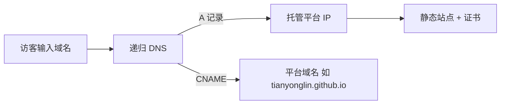

# 第六部分：域名、DNS、HTTPS、CDN 与缓存

## 1. DNS 基础（1 分钟版）



- **A 记录**：域名 → IP 地址；**CNAME**：域名 → 另一个域名；
- **NS（名称服务器）**：决定“谁来管这个域名的记录”。改托管商（如交给 Cloudflare）= 改 NS；
- DNS 修改全球生效需 **几分钟~48 小时**（通常 1 小时内），改完不生效先等，别反复改。

## 2. 完整解析配置

### 方案 A：GitHub Pages（DNS 留在原注册商）

| 类型 | 主机记录 | 记录值 | 作用 |
|---|---|---|---|
| A | @ | 185.199.108.153 | 裸域 sunmusic.top |
| A | @ | 185.199.109.153 | 同上（冗余） |
| A | @ | 185.199.110.153 | 同上（冗余） |
| A | @ | 185.199.111.153 | 同上（冗余） |
| CNAME | www | tianyonglin.github.io | www 子域 |

删除注册商可能预置的其它 A/AAAA/CNAME 记录，避免冲突。

### 方案 B：Cloudflare Pages（DNS 托管在 Cloudflare）

| 类型 | 名称 | 内容 | 代理状态 |
|---|---|---|---|
| CNAME | www | 项目名.pages.dev | Proxied（橙色云） |
| CNAME | @ | 项目名.pages.dev | Proxied（根域 CNAME 自动扁平化） |

> 由 Custom domains 界面添加时这些记录自动创建，手动添加时注意代理状态。

### 验证 DNS（执行环境：任意终端，无需安装工具——Windows 自带 `nslookup`）

```bash
nslookup sunmusic.top        # 应返回 CNAME / A 指向托管平台
nslookup sunmusic.top
```

## 3. HTTPS

| 平台 | 机制 | 续期 |
|---|---|---|
| GitHub Pages | 绑定自定义域名后自动签发 Let's Encrypt 类证书 | 全自动 |
| Cloudflare | 边缘证书自动签发（源站为 Pages，端到端加密） | 全自动 |

**要点**：
- 证书签发需要 DNS 先指向正确，绑定后若显示灰色/失败，等 10 分钟~24 小时；
- GitHub Pages 记得勾 **Enforce HTTPS**（强制跳转 + HSTS）；
- Cloudflare 建议：SSL/TLS 模式选 **Full**（Pages 源站本身有证书），并开启 **Always Use HTTPS**（Rules 默认已有建议项）。
- 无服务器、无 certbot，**不存在手工续期**这回事。

## 4. CDN 与缓存

- GitHub Pages 自带 Fastly CDN；Cloudflare Pages 自带其全球 CDN。均免费、无需配置即生效。
- **资源指纹**：Hugo 构建的 CSS/JS 文件名含哈希（如 `style.min.7ed1….css`），可放心设长缓存；
- **HTML 不缓存**：两个平台默认对 HTML 短缓存/回源，更新文章后通常秒级~分钟级可见；
- Cloudflare 可选增强（面板 → Caching → Configuration）：
  - Browser Cache TTL：`Respect Existing Headers`；
  - 发布后想立刻刷新：用 **Caching → Purge Cache** 输入首页与文章 URL。
- 若使用橙色云（Proxied），注意 GitHub Pages 场景不要套 Cloudflare 代理（证书冲突）；二选一架构见文档 05。

## 5. 域名安全设置（在注册商处）

1. 开启**两步验证**（2FA/Passkey）；
2. 打开**域名锁（Registrar Lock / 禁止转移锁）**；
3. 设置**转移码保护**，不向任何人泄露 Auth Code；
4. 联系邮箱用长期可用的邮箱；
5. 记下**到期日并设日历提醒**（到期未续费会被他人抢注，这是个人站最大风险）。

## 6. 缓存/更新类问题速查

| 现象 | 处理 |
|---|---|
| 文章已发布但页面是旧的 | 浏览器强制刷新（Ctrl+Shift+R）；CF 用户 Purge 对应 URL |
| 换域名后样式丢失 | `baseURL` 未改或末尾缺 `/`，检查 `hugo.toml` |
| https 能开但 http 不跳转 | GitHub 未勾 Enforce HTTPS / CF 未开 Always Use HTTPS |
