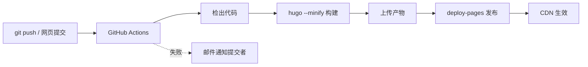

# 第十一部分：自动化构建、部署与持续维护

## 1. CI/CD 现状（已配置）



文件：`.github/workflows/hugo.yml`（锁定 Hugo `0.167.0`，构建 `--minify`，产物 `public/`）。
触发：`main` 分支推送；支持手动（Actions → workflow → Run workflow）。

## 2. 分支与环境策略

| 环境 | 机制 |
|---|---|
| 生产 | `main` 分支推送即发布 |
| 草稿 | 文章 front matter `draft: true`（构建时被排除，可提前入库） |
| 试验 | 建分支改动，Actions 会在该分支运行构建（GitHub Pages 只发布 main，可安全试错）；Cloudflare Pages 路线则自动生成 PR 预览链接 |

## 3. 环境变量与机密

- 当前流程**无需任何密钥**（公开仓库 + Pages 官方 Action）；
- 若未来需要密钥：仓库 Settings → Secrets and variables → Actions 中添加，工作流里 `${{ secrets.名字 }}` 引用，**永不硬编码**。

## 4. 持续维护日历

| 频率 | 事项 |
|---|---|
| 每次发布 | Actions 绿灯；首页/新文章页点开正常 |
| 每周 | 看一次 GSC 邮件摘要（索引、抓取异常） |
| 每月 | ① 死链检查（见下）② 看统计趋势 ③ 更新一次 `changelog` |
| 每季度 | Hugo/主题版本评估；备份一次仓库（文档 08 第 5 节） |
| 每半年 | 通读 About/项目/友链页，更新过时信息；清理失效友链 |
| 每年 | 备份恢复演练；域名续费检查；复查隐私政策与第三方服务清单 |

## 5. 死链检查（每月）

方案一（无需安装，网页版）：把主要页面贴进在线检查器。
方案二（推荐，加个定时工作流）：新建 `.github/workflows/links.yml`，用 [lychee](https://github.com/lycheeverse/lychee-action) 每月扫全站外链，失效时给你发 Issue。参考配置：

```yaml
# .github/workflows/links.yml
name: Links
on:
  schedule: [{ cron: "0 3 1 * *" }]   # 每月 1 日
  workflow_dispatch:
jobs:
  linkChecker:
    runs-on: ubuntu-latest
    steps:
      - uses: actions/checkout@v4
      - name: Link Checker
        id: lychee
        uses: lycheeverse/lychee-action@v2
        with:
          args: --base . --accept 429,999 --no-progress --exclude-loopback 'content/**/*.md'
          fail: false
      - name: Create Issue From File
        if: steps.lychee.outputs.exit_code != 0
        uses: peter-evans/create-issue-from-file@v5
        with:
          title: Link Checker Report
          content-filepath: ./lychee/out.md
          labels: report
```

## 6. 内容运营节奏建议

1. **频率**：可持续的最低频率（如每月 1~2 篇）> 爆发后断更；
2. **选题池**：随手记录灵感（备忘录/仓库里开个 `ideas.md`）；
3. **更新机制**：旧文有实质修订时改 `lastmod` 并在文末加一行「更新记录」；
4. **发布后**：重要文章在 GSC 请求索引；社交渠道分享（分享按钮现成）。
